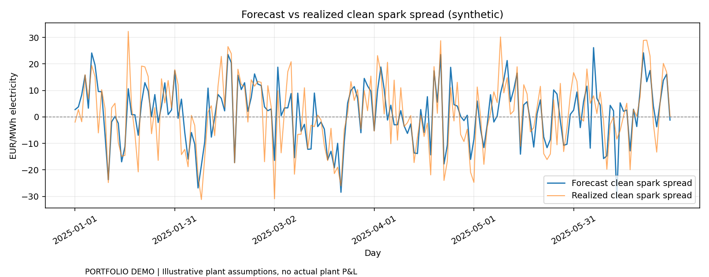

# European Power Trading & Clean Spark Spread

**[▶ Launch the interactive Streamlit demo](https://european-power-clean-spark-prapt5tlrlgj7vg4stq4jg.streamlit.app)** — try the dashboard in your browser, no Python installation needed.

**Explore:** [Python source](src/) · [Streamlit app code](app.py) · [Unit tests](tests/) · [Chart preview](assets/power-preview.png) · [Run instructions](#run)

*The default example uses synthetic inputs; this is educational research, not live trading or an investment recommendation.*


**Cross-commodity power/gas/EUA economics and forecast-driven CCGT dispatch research.**



> Portfolio demonstration, **not a live EPEX SPOT / EEX / ICE strategy**. The included market series are deterministic **synthetic examples**; users can upload their own time-aligned observations.

## Why clean spark spread?

For a gas-fired power plant, the simplified **clean spark spread** per MWh of electricity is:

```text
CSS (€/MWh_e) = Power(€/MWh_e)
                − Gas(€/MWh_th) / efficiency
                − EUA(€/tCO2) × emissions(tCO2/MWh_th) / efficiency
                − variable O&M (€/MWh_e)
```

A positive spread suggests a favorable variable contribution margin under the assumed plant configuration, **not** guaranteed profit.

## What this project does

- Calculates CSS from power, gas and EU ETS allowance prices.
- Models a CCGT (efficiency, thermal emissions intensity, capacity, variable costs).
- Schedules next-day dispatch from **forecast power** and **forward fuel/carbon** inputs.
- Scores **realized gross contribution** with subsequent realized prices (no realized-price lookahead in the signal).
- Plots ex-ante versus ex-post CSS and cumulative contribution; exports decisions.

## Quick start

```bash
python -m venv .venv
# Windows: .venv\Scripts\activate
# macOS/Linux: source .venv/bin/activate
python -m pip install -e '.[dev]'
streamlit run app.py
```

CLI: `python examples/run_demo.py`  
Tests: `python -m pytest -q`

## Market input CSV

`data/power_market_example.csv` shows the required schema:

```text
date,forecast_power,forward_gas,forward_eua,realized_power,realized_gas,realized_eua,hours
```

All power prices in **€/MWh electric**, fuel in **€/MWh thermal** and EUA in **€/tCO2**. `hours` means eligible daily operating hours (1–24). Each date represents one **delivery-day observation**, with forecasts assumed available *before* the generation decision and realizations available afterward. The app doesn't fetch or validate real market timestamps.

## Boundaries

Gross margin does not include start-up costs, minimum uptime, ramping, unit commitment, no-load costs, hedge slippage, outages, balancing penalties, transmission, financing, or counterparty risk. The backtest is an illustrative **dispatch profitability model, not a tradeable strategy performance estimate**. To turn it into execution-grade research, align EPEX day-ahead auction publication times, gas/EUA hedge quotes, plant constraints and operational costs.

License: MIT.

## Real market observations (user-provided CSV)

The CSV import already accepts timestamp-aligned **real historical day-ahead** observations, so the demo supports a hybrid synthetic/real workflow without distributing licensed prices. A credible EU dataset needs electricity delivery-day prices (e.g., ENTSO-E or EPEX), gas prices (EEX/ICE TTF, properly unit- and timestamp-matched), EUA carbon prices (EEX/ICE, correctly timestamped), and forecasts **available before dispatch**. Do not insert realized day-ahead prices into the forecast columns; that creates look-ahead bias. Record market area, time zone, source and date range, plant efficiency and availability. Electricity prices from [ENTSO-E Transparency Platform](https://transparency.entsoe.eu/) may require an API token and carry provider terms; TTF/EUA forward price redistribution is often licensed. We deliberately do not fabricate actual historical forward quotes or publish restricted datasets.
